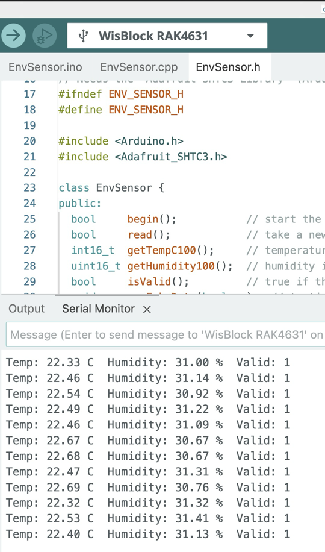

## Team Members
| Name | GitHub Username | Responsibility |
|------|-----------------|----------------|
| Andy Holt | Andy-Holt | Environmental Sensor |

## Individual Contribution: Andy Holt

### My Responsibility
I built the Environmental Sensor Module (`EnvSensor`). It reads temperature and humidity from the RAK1901 (SHTC3) sensor over I2C on the RAK4631, checks that the values are good, and passes them to the data packet module as scaled integers.

**Code:** [modules/EnvSensor](https://github.com/Cookiepie2256/ECE3730_Team-A_DesertLink/tree/main/modules/EnvSensor)

### My Files
- `EnvSensor.h`: class declaration
- `EnvSensor.cpp`: sensor startup, reading, and range checks
- `EnvSensor.ino`: test sketch (Serial Monitor at 115200)

Needs the **Adafruit SHTC3** library.

### How to Use
```cpp
EnvSensor env;
env.begin();   // in setup()
env.read();    // in loop()
codec.packEnvironment(env.getTempF(), env.getHumidity());
```

### My Inputs and Outputs
| Direction | Data | Type / Units | Source or Destination |
|-----------|------|--------------|-----------------------|
| Input | Temperature and humidity | I2C, address 0x70 | RAK1901 sensor |
| Input | Read request | `env.read()` | Main loop |
| Output | Temperature | `float`, °F | Malainy's `packEnvironment()` |
| Output | Humidity | `float`, % | Malainy's `packEnvironment()` |
| Output | Valid flag | `bool` | Main loop (skip bad readings) |

### My Test Results
Tested on the RAK4631.

| Test | Expected | Observed |
|------|----------|----------|
| Upload and run | Readings every 2 s | Pass |
| Normal reading | Values near room temp and humidity | Pass: about 22.5 C, 31 % |
| No sensor attached | "Valid: 0" | Pass |

**Screenshot:**

