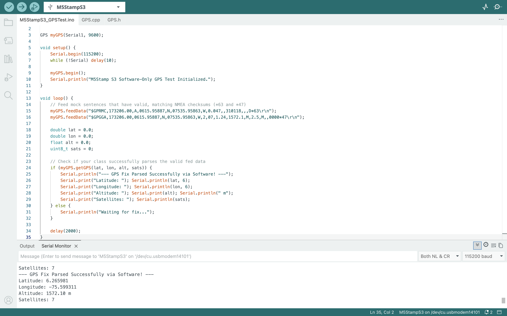

| Information | Entry |
|---|---|
| **Student** | Gage Bonds |
| **Team** | Desert Link |
| **Module** | GPS (RAK12501 / Quectel L76K) |
| **Date** | November 7, 2026 |
| **Repository link** |https://github.com/Cookiepie2256/ECE3730_Team-A_DesertLink/tree/main/modules/GPS|

## 1. Library Use and Interface

This library provides an object-oriented C++ wrapper for the RAK12501 (Quectel L76K) GNSS module on the RAK4631. It uses the `TinyGPSPlus` library under the hood to parse incoming NMEA sentences via hardware serial.

| Public function | Inputs | Returns or output | Purpose and use notes |
|---|---|---|---|
| `RAK12501_GPS` | `HardwareSerial &serialPort` (default `Serial1`), `uint32_t baudRate` (default `9600`) | None (Constructor) | Instantiates the GPS object bound to the specified hardware serial port. |
| `begin` | None | `bool` | Initializes the serial interface (`Serial1.begin()`). Call this once in `setup()`. |
| `update` | None | `void` | Reads available bytes from the module and feeds the internal parser. Must be called frequently. |
| `getGPS` | `double &latitude`, `double &longitude`, `float &altitude`, `uint8_t &satellites` | `bool` | Returns `true` and updates passed variables by reference when fresh valid fix data is available. Call in `loop()`. |
| `isLocationValid` | None | `bool` | Returns `true` if the current location fix is valid. |
| `getAge` | None | `uint32_t` | Returns the age of the last data fix in milliseconds. |

### Example of Use by Another Team Member

To use this library in your own sketch or module, include the header file, instantiate the object, initialize it in `setup()`, and call `getGPS()` inside your `loop()`.

```cpp
#include "RAK12501_GPS.h"

// Instantiate GPS using default Serial1 (RAK4631 slot UART) and 9600 baud
RAK12501_GPS myGPS(Serial1, 9600);

void setup() {
    Serial.begin(115200);
    while (!Serial) delay(10);

    // Initialize the module serial communication
    if (myGPS.begin()) {
        Serial.println("RAK12501 GPS initialized successfully.");
    } else {
        Serial.println("Initialization failed.");
    }
}

void loop() {
    double lat = 0.0;
    double lon = 0.0;
    float alt = 0.0;
    uint8_t sats = 0;

    // Retrieve GPS fix data when updated
    if (myGPS.getGPS(lat, lon, alt, sats)) {
        Serial.print("Lat: "); Serial.println(lat, 6);
        Serial.print("Lon: "); Serial.println(lon, 6);
        Serial.print("Altitude: "); Serial.print(alt); Serial.println(" m");
        Serial.print("Satellites: "); Serial.println(sats);
    }

    delay(1000);
}
```

## 2. Testing and Results

| Test Item | Description |
| :--- | :--- |
| **Test Setup** | M5Stamp S3 microcontroller running software-in-the-loop (SITL) testing. The custom `GPS` class uses `TinyGPSPlus` to parse mock NMEA sentences injected via software (`feedData()`). Connected to a PC via USB with Serial Monitor output at 115200 baud. |
| **Test Procedure** | 1. Uploaded the test sketch containing valid, checksum-compliant NMEA sentences to the M5Stamp S3.<br>2. Opened the Arduino IDE Serial Monitor at 115200 baud.<br>3. Verified that the custom `GPS` class successfully intercepted, decoded, and parsed the mock data stream. |
| **Expected Result** | The parser should successfully validate the NMEA checksums, extract the structured data fields, and output clean decimal coordinates, altitude, and satellite counts to the Serial Monitor. |
| **Observed Result** | The parser successfully decoded the mock NMEA sentences. The Serial Monitor printed stable latitude, longitude, altitude, and satellite values, confirming that the C++ library architecture and parsing logic operate correctly prior to physical hardware deployment. |



## 3. Current Status and Integration Notes


| Item | Notes |
|---|---|
| **Working** | Hardware serial initialization, NMEA byte streaming, `TinyGPSPlus` integration, and coordinate/altitude/satellite extraction via `getGPS()`. |
| **Known issues** | Indoor testing yields no fix due to concrete/roof obstruction blocking GNSS signals (normal behavior requiring line-of-sight). |
| **Integration notes** | Requires the `TinyGPSPlus` library installed in the Arduino IDE. Must use `Serial1` on the RAK4631. Ensure `update()` or `getGPS()` is called frequently in the main loop to prevent serial buffer overflow. |
| **Next step** | Package the extracted latitude, longitude, and altitude variables into a binary payload struct for transmission over the RAK4631's LoRa/LoRaWAN radio module. |

## Submission Checklist

- [x] Completed report with description of test results
- [x] Library header file (`GPS.h`) and implementation file (`GPS.cpp`)
- [x] Test sketch (`M5StampS3_GPSTest.ino`) that calls the library’s public functions
- [x] Short demonstration video showing the library working
- [x] All files pushed to the team GitHub repository
