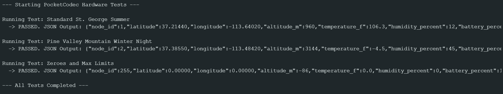

# Individual Library Documentation

**ECE 3730 | Monitoring System Project | Assignment 1**


| Information | Entry |
|---|---|
| **Student** | Malainy |
| **Team** | Desert Link |
| **Module** | Packet Encoding (PocketCodec) |
| **Date** | November 9, 2026 |
| **Repository link** | ttps://github.com/Cookiepie2256/ECE3730_Team-A_DesertLink/blob/main/malainy.md |

## 1. Library Use and Interface

| Public function | Inputs | Returns or output | Purpose and use notes |
|---|---|---|---|
| `PocketCodec(uint8_t nodeId)` | `uint8_t nodeId` (0-255) | `PocketCodec` object | Constructor for the wearable node. Initializes payload memory to zero and sets the node ID. |
| `PocketCodec()` | None | `PocketCodec` object | Constructor for the base station. Initializes an empty payload ready to receive data. |
| `packLocation()` | `float latitude`, `float longitude`, `float altitudeMeters` | `void` | Stores GPS coordinates. Altitude is cast to a 2-byte integer, dropping decimal precision. |
| `packEnvironment()` | `float tempFahrenheit`, `float humidityPercent` | `void` | Compresses environment data. Temp is multiplied by 10 and cast to a 2-byte int; humidity decimals are dropped. |
| `packSystemState()` | `float batteryPercent`, `uint8_t statusFlag`, `uint32_t uptimeSeconds` | `void` | Stores battery and status. Converts uptime from seconds to minutes (2-byte int) to save space. |
| `getEncodedBytes()` | None | `uint8_t*` (byte array pointer) | Returns the pointer to the compressed 18-byte payload to be handed to the LoRa transmission function. |
| `getPayloadSize()` | None | `size_t` (integer) | Returns the exact size of the payload (18 bytes). |
| `loadPayload()` | `uint8_t* rawLoRaData` | `void` | Base station function. Copies an incoming 18-byte LoRa packet into the internal struct for unpacking. |
| `unpack...()` functions | None | `float`, `int16_t`, or `uint8_t` depending on metric | Extracts individual metrics. `unpackTemperature()` automatically divides the stored integer by 10.0 to restore the decimal. |
| `toJSON()` | None | `String` | Formats all unpacked data into a JSON string for easy base station monitoring and mapping. |

### Example of Use by Another Team Member


```cpp
#include "PocketCodec.h"

// Instantiate the codec globally for Node 1
PocketCodec nodeData(1); 

void setup() {
  Serial.begin(115200);
  
  // Simulated sensor data
  float currentLat = 37.20105;
  float currentLon = -112.98845;
  float currentAlt = 1250.0;
  float currentTemp = 98.5;
  float currentHum = 14.2;
  float currentBatt = 88.5;
  uint32_t currentUptime = 3600; // 1 hour

  // Pack the data
  nodeData.packLocation(currentLat, currentLon, currentAlt);
  nodeData.packEnvironment(currentTemp, currentHum);
  nodeData.packSystemState(currentBatt, 0, currentUptime);

  // Get the byte array for LoRa transmission
  uint8_t* txBuffer = nodeData.getEncodedBytes();
  size_t packetSize = nodeData.getPayloadSize();

  // (LoRa transmission logic goes here using txBuffer and packetSize)
}

void loop() {
}
```

## 2. Testing and Results

| Test item | Description |
|---|---|
| **Test setup** | M5StampS3 microcontroller connected via USB-C, simulating sensor data injections. Output monitored via the Arduino IDE Serial Monitor at 115200 baud. |
| **Test procedure** | Instantiated the `PocketCodec` sender class with simulated environmental data representing St. George summer conditions (high heat, low humidity) and Pine Valley winter conditions (negative temperatures, high altitude). Extracted the compressed byte array, loaded it into a separate `PocketCodec` receiver instance, and asserted that the unpacked JSON values matched the inputs. |
| **Expected result** | The payload should remain exactly 18 bytes. The unpacked data should match the input variables, with the expected precision loss for humidity (decimals dropped) and temperature (hundredths/thousandths dropped). Negative numbers and high integer limits should not overflow. |
| **Observed result** | All assertions passed. The 18-byte struct maintained data integrity. Truncation behaved exactly as designed (e.g., 106.34°F input was successfully restored as 106.3°F). |

Insert a readable screenshot or photo of the test output. Add a caption identifying
what it shows. Do not include unrelated desktop content.

> 
>
> *Caption: Serial monitor output demonstrating successful packing, unpacking, and JSON formatting of the 18-byte payload across extreme weather test cases.*

## 3. Current Status and Integration Notes


| Item | Notes |
|---|---|
| **Working** | Data compression math, 18-byte struct memory alignment, node ID assignment, and base station JSON formatting. |
| **Known issues** | None known. |
| **Integration notes** | Ensure `#include "PocketCodec.h"` is at the top of the main sketch. The payload size is rigidly fixed at 18 bytes. Teammates must remember that `uptimeSeconds` is converted to minutes internally, meaning exact second-level precision is intentionally lost to save memory space. |
| **Next step** | Hand off the `getEncodedBytes()` pointer to the team member writing the Meshtastic/LoRa transmission module to execute the over-the-air tests. |

## Submission Checklist

- [x] Completed report with screenshot or photo of test output
- [x] Library header file (`.h`) and implementation file (`.cpp`)
- [x] Test sketch (`.ino`) that calls the library’s public functions
- [x] Short demonstration video showing the library working
- [x] All files pushed to the team GitHub repository

---

*ECE 3730 | Individual Library Documentation*